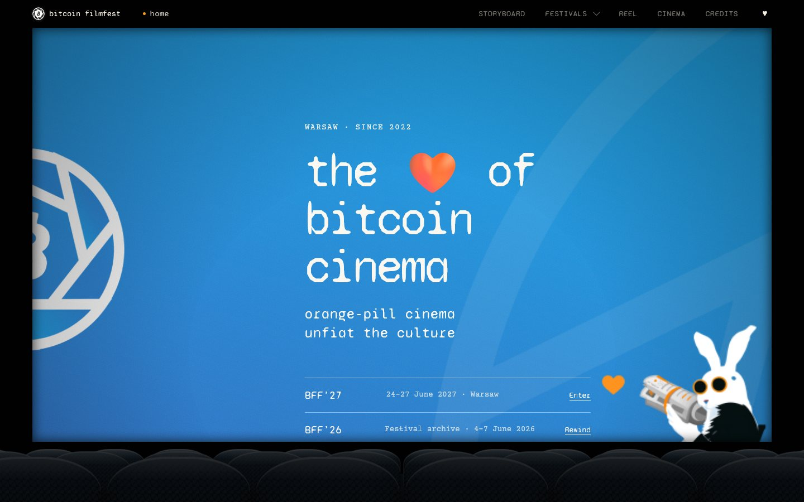

<div align="center">

# Bitcoin FilmFest 🧡

**The heart of Bitcoin cinema. Orange-pill cinema, unfiat the culture.**

An independent festival in Warsaw, a public database of Bitcoin films, and a community of people who make and love them.

[🌐 bitcoinfilmfest.com](https://bitcoinfilmfest.com) · [🎞️ Film database](https://bitcoinfilmfest.com/cinema/films/) · [🐇 BFF'27](https://bitcoinfilmfest.com/27/) · [💬 Telegram](https://telegram.bitcoinfilmfest.com) · [𝕏 @bitcoinfilmfest](https://x.com/bitcoinfilmfest) · [📸 Instagram](https://instagram.com/bitcoin_filmfest) · [💼 LinkedIn](https://linkedin.com/company/bitcoin-filmfest) · [🟣 Nostr](https://primal.net/p/npub1rjtrs7xqdvj3588r9njrexh2n750j7jdwx9qs543nutmdsj6ljaqpfmp8a)

<br>

<a href="https://bitcoinfilmfest.com"></a>

</div>

---

## 👋 Hi, we are Bitcoin FilmFest

We believe stories change culture. So we show Bitcoin films on a big screen, keep a public record of every Bitcoin movie and studio we can verify, and bring filmmakers, producers and cinema fans together in one place.

Our motto is **Unfiat the Culture**. Every screening, every database entry and every conversation is a small push towards art and storytelling that runs on sound money.

This repository is the source code and content of [bitcoinfilmfest.com](https://bitcoinfilmfest.com). If you landed here by accident: **[open the site](https://bitcoinfilmfest.com)**, you do not need to read any code to enjoy it. 🍿

## 🟢 Where things stand

**The site is live** at [bitcoinfilmfest.com](https://bitcoinfilmfest.com), built from this repo and published with GitHub Pages every time `main` changes.

- 🐇 **BFF'27** is next: **24 to 27 June 2027 at Kinoteka in Warsaw**. The edition page is up, tickets and the programme are still to come.
- 🎬 **Four festivals so far in Warsaw:** BFF'23 (March 2023), BFF'24 (April 2024), BFF'25 (22 to 25 May 2025) and BFF'26 (4 to 7 June 2026). Each has an archive page.
- 🏆 **Golden Rabbits:** the award winners from 2023 to 2026 live on the [awards page](https://bitcoinfilmfest.com/awards/).
- 🎞️ **Bitcoin Cinema database:** 65 films, documentaries and series, plus a directory of production companies, all with sources. It keeps growing.
- 🗺️ **BFF minis and roadshows:** screenings at conferences in Lisbon, Lugano, San Salvador, Cape Town, Funchal and Maribor.
- 📰 **Reel and Chronicle:** interviews, articles, newsletters and news from the Bitcoin cinema world.
- 🧰 **Press kit:** official logos, rabbit mark, posters and laurels at [/presskit/](https://bitcoinfilmfest.com/presskit/).

Still ahead: BFF'27 tickets and the programme, added when they exist.

## 🤝 Come build it with us

Bitcoin cinema is young and there is room for everybody. You can help even if you have never opened a code editor.

- 🎥 **Have a film, or know one?** Tell us. Missing titles and wrong details in the database are the most useful reports we get. Open an [issue](https://github.com/itstomekk/bitcoinfilmfest-com/issues) or write to [info@bitcoinfilmfest.com](mailto:info@bitcoinfilmfest.com).
- ✍️ **Spot a typo, a dead link or a wrong date?** Send a pull request. Most pages are plain Markdown, so a fix can be a few lines in one file.
- 🙋 **Want to volunteer, show your work, or partner on an edition?** See the [Contribute page](https://bitcoinfilmfest.com/join/) or say hi on [Telegram](https://telegram.bitcoinfilmfest.com).
- ⚡ **Want to support the festival with sats?** The lightning address is `bitcoinfilmfest@getalby.com`.

Small, focused pull requests are easiest to review. The full how-to, including what to edit for a film, a company or a news item, is in [DEVELOPMENT.md](DEVELOPMENT.md).

## 🔒 Please keep it public-safe

This repository is public, so everything committed here can be read by anyone. Never commit passwords, keys, cookies, mailing-list exports, contracts or private production notes. A safety check runs on every pull request. Details: [docs/PUBLIC-REPO-SAFETY.md](docs/PUBLIC-REPO-SAFETY.md).

## 🛠️ For developers

A static [Jekyll](https://jekyllrb.com/) site: Markdown and YAML content, a shared "cinema frame" design system, GitHub Actions to build and GitHub Pages to publish. No server, no database.

```bash
cd site
bundle install
bundle exec jekyll serve --host 127.0.0.1 --port 4000
```

Open `http://127.0.0.1:4000/`. Windows commands, project structure, content guide, contribution workflow and decision log: **[DEVELOPMENT.md](DEVELOPMENT.md)**.

## 📄 License and content use

There is no open-source license file in this repository yet. Code and content may carry different rights. Please do not reuse festival logos, photography, film stills, contributor names or third-party editorial material without checking the relevant permission. If you want to reuse something, just ask: [info@bitcoinfilmfest.com](mailto:info@bitcoinfilmfest.com).

<div align="center">

**Don't trust, verify.** ⚡ Made with 🧡 in Warsaw.

</div>
